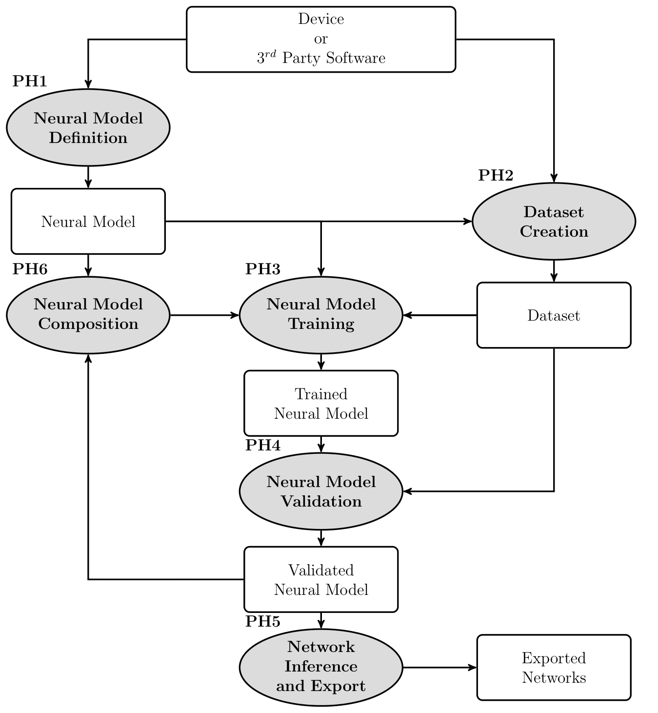

nnodely
=======

.. image:: _static/logo_white_info.png
   :target: https://github.com/tonegas/nnodely
   :alt: nnodely

*nnodely* is a framework for building and deploying **Model-Structured Neural
Networks** (MS-NNs).

Modeling, control and estimation of physical systems impose constraints that
differ from typical deep-learning tasks. Models often have to respect known
physical laws, run in real time, stay interpretable, and generalize from limited
experimental data. MS-NNs combine the learning capabilities of neural networks
with structural priors grounded in physics, control and estimation theory:

- **Data efficiency**: structural priors let a model learn from limited data.
- **Generalization**: domain knowledge helps the model behave well in unseen scenarios.
- **Interpretability**: every block of the network has a physical meaning.
- **Real time**: the resulting networks are small and can be exported for deployment.

*nnodely* is not a replacement for a general-purpose deep-learning framework.
It is a structured layer on top of `Keras 3 <https://keras.io>`_, so the same
model runs on the TensorFlow, PyTorch or JAX backend.

.. raw:: html

   

     <a href="https://github.com/tonegas/nnodely"
        style="display:inline-block; font-weight:900; font-size:1.2em;
               padding:0.5em 0.9em; border-radius:10px;
               border:2px solid #3981BC; text-decoration:none;">
       Repository
     </a>
     <a href="getting_started.html"
        style="display:inline-block; font-weight:900; font-size:1.2em;
               padding:0.5em 0.9em; border-radius:10px;
               border:2px solid #3981BC; text-decoration:none;">
       Getting Started
     </a>
     <a href="https://github.com/tonegas/nnodely-applications"
        style="display:inline-block; font-weight:900; font-size:1.2em;
               padding:0.5em 0.9em; border-radius:10px;
               border:2px solid #3981BC; text-decoration:none;">
       Applications
     </a>
   

Workflow
--------

.. sidebar:: Development pipeline

   Ellipses are the phases of the pipeline, rectangles the artifacts each phase
   produces.

Working with *nnodely* follows the phases of the diagram. Each phase has a
guide page, which explains it on one example, and a tutorial, a notebook to
run and change:

.. list-table::
   :header-rows: 1
   :widths: 40 30 30

   * - Phase
     - Guide
     - Tutorial
   * - **Model definition**: the structure of the network, with inputs,
       layers and outputs.
     - :doc:`guide/models`
     - :doc:`tutorial/01_model_design`
   * - **Dataset creation**: recorded or simulated signals cut into the
       windows the model reads.
     - :doc:`guide/data`
     - :doc:`tutorial/02_data_management`
   * - **Training**: the objectives to minimize, and any Keras optimizer.
     - :doc:`guide/training`
     - :doc:`tutorial/03_model_training`
   * - **Validation**: system-identification indicators and plots.
     - :doc:`guide/validation`
     - :doc:`tutorial/04_model_validation`
   * - **Inference and export**: run, save, or export to Keras and ONNX.
     - :doc:`guide/export`
     - :doc:`tutorial/05_save_load_export`
   * - **Composition**: trained models reused as blocks of larger ones.
     - :doc:`guide/composition`
     - :doc:`tutorial/01_model_design`

Start with :doc:`getting_started`, which builds, trains and runs a first model
in a few minutes.

Contents
--------

.. toctree::
   :maxdepth: 2

   getting_started
   guide/index
   tutorial/index
   api/index
   glossary

Indices and tables
------------------

* :ref:`genindex`
* :ref:`search`
